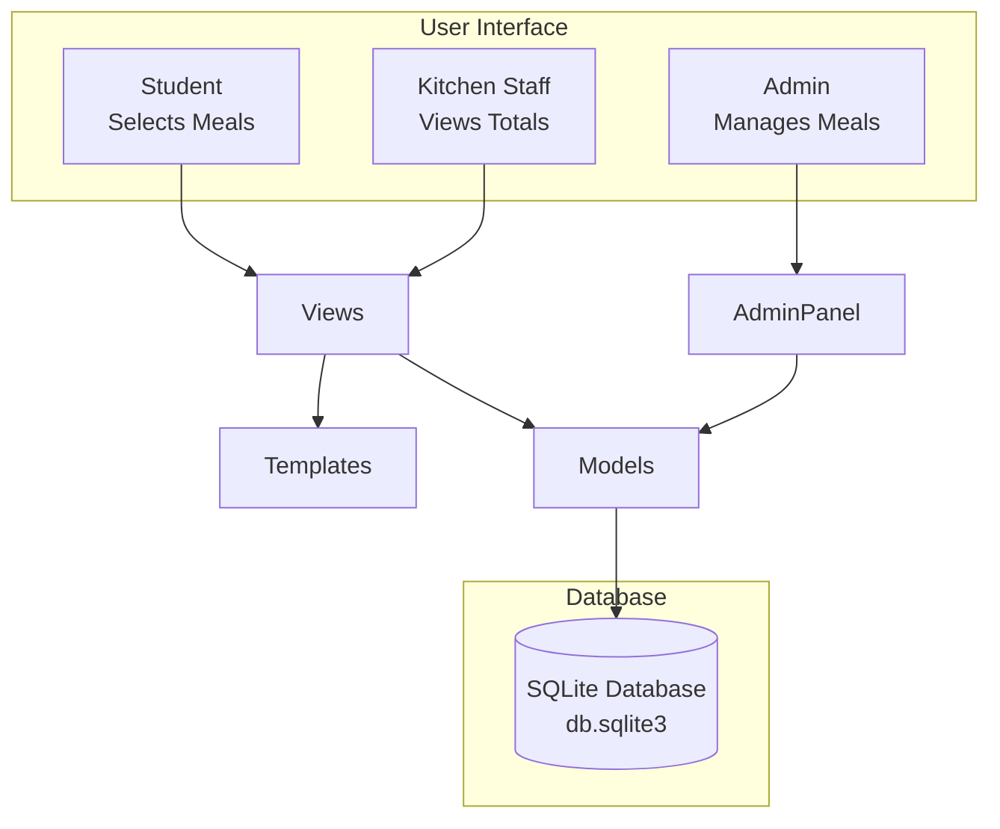
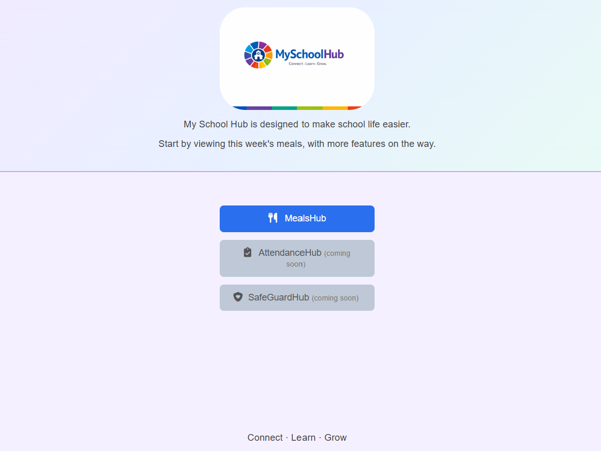
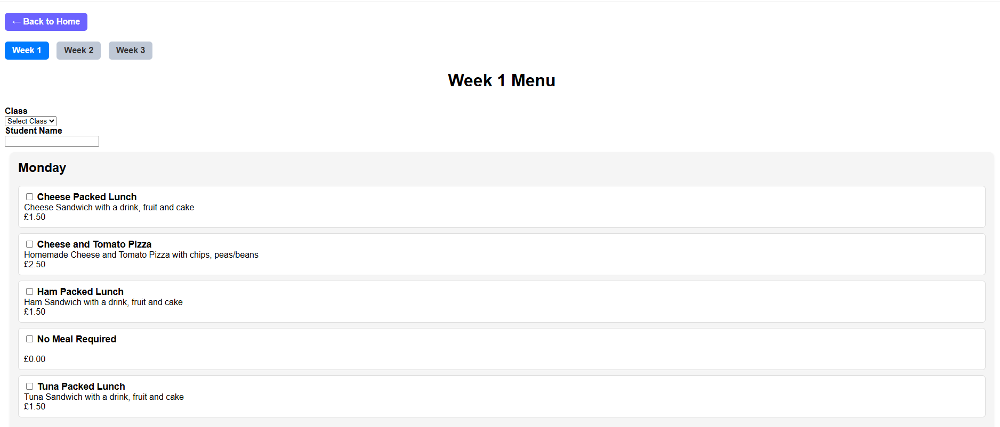
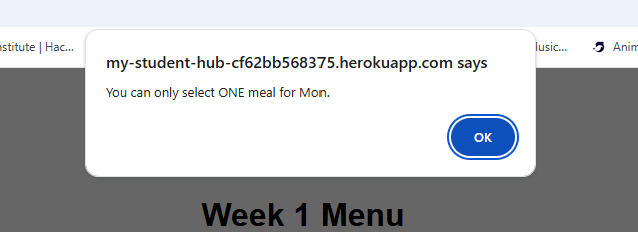
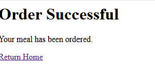
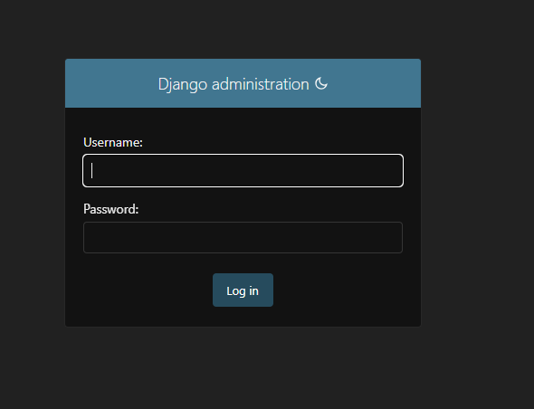
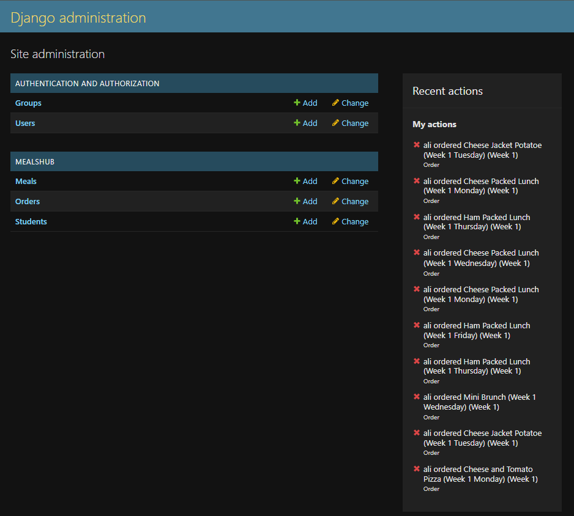
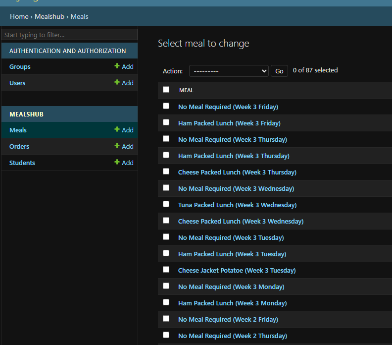
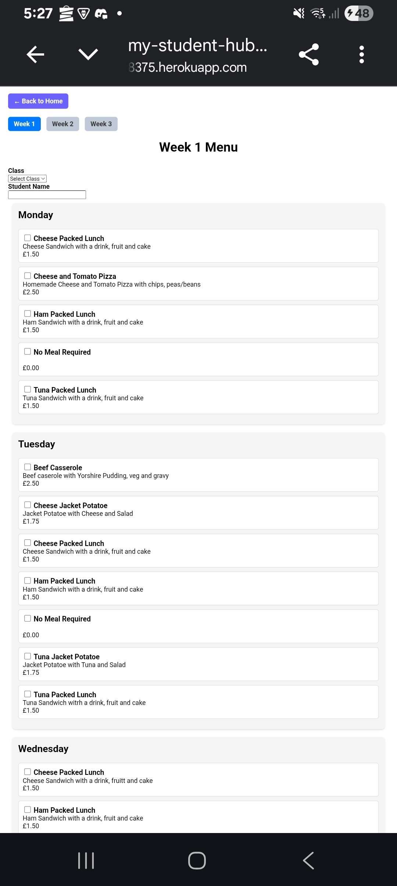

# MySchoolHub Platform


# 🏫 Overview


MySchoolHub is a modular school management platform designed to simplify everyday school processes through a collection of dedicated hubs

The current version includes:

- MealsHub - a weekly school meal ordering system.
- SchoolTripsHub - a school trip booking and parental consent system.
- User Authentication - secure login functionality using Django's built-in authentication system.


MySchoolHub has been designed with future expansion in mind. Additional modules such as AttendanceHub and SafeguardingHub are planned for future development, allowing the platform to grow while maintaining a clear and manageable structure.

The project aims to reduce paperwork, improve data accuracy, streamline administrative tasks, and provide a more efficient experience for staff, pupils and parents.

---

# 🎯 Project Rationale
Many schools still rely on paper forms and manual processes for routine activities such as meal ordering and school trip consent.

These processes can result in:

- Administrative workload
- Lost paperwork
- Inaccurate records
- Delays in communication
- Difficulties tracking consent and payments

MySchoolHub provides a digital solution that centralises these activities into a single web application.

MealsHub supports efficient meal ordering and planning while SchoolTripsHub allows parents to view trips, provide consent, supply medical information and record payment intentions.

The modular design allows new school services to be added over time without disrupting existing functionality.

---


# 🧩 Current Features

## MealsHub

### Parent/Student Features

- View weekly menu options
- Select one meal per day
- Submit meal order
- Use "No Meal" option where appropriate
- Mobile-friendly layout

### Kitchen Staff Features

- View submitted orders
- View meal totals
- Review orders by week and day

### Admin Features

- Add meals
- Edit meals
- Delete meals
- Manage meal availability
- View submitted orders

---

## SchoolTripsHub

### Parent Features

- View available school trips
- Book places on school trips
- Provide parental consent
- Submit medical information
- Choose payment method
- Enter voluntary contribution amounts
- Receive booking confirmation

### Admin Features

- Create trips
- Edit trip information
- View bookings
- View associated payment options
- Review medical information and consent status

---

## Authentication

- User login functionality
- Session management
- Secure authentication using Django's built-in user model


---

# 🗂️ Database Structure

## Student

Stores pupil information

## Meal

Stores meal details, availability, day and week

## Order

Stores meal selections made by students and parents

## Trip

Stores school trip information including:

- Name
- Date
- Price

## Booking

Stores school trip bookings including:

- Trip
- Parent name
- Medical notes
- Consent confirmation
- Payment option
- Contribution amount


---

# 🖥️ Interface Preview (Current Behaviour)

 **Weekly Menu Page**
- Days grouped Mon-Fri
- Each day shows available meals
- One checkbox per meal
- "No Meal" option included
- Student name field at the top
- One "Submit Weekly Order" button

**Order Success Page**

- Simple confirmation screen


---

# 🌱 Future Enhancements

## Planned Improvements

These features build upon the current functionality of MealsHub and SchoolTripsHub.

- Improved logout functionality
- Online payment integration
- Automatic trip selection when booking
- Conditional display of contribution amount fields
- Editable trip bookings
- Booking cancellation functionality
- User booking history
- Kitchen dashboard with improved reporting
- Order summary before meal submission

## Future Modules

These modules form part of the long-term vision for MySchoolHub.

### AttendanceHub
Digital attendance tracking for classes and year groups.

### SafeguardingHub
A safeguarding and welfare recording system inspired by CPOMS.

### CommsHub
Communication system for parents, staff and students.

### UniformHub
School uniform ordering and management functionality.
---

# 🛠️ Technologies Used

- **Python** - core programming language
- **Django** - web framework for models, views, admin, and routing
- **HTML/CSS** - front-end structure and styling
- **SQLite** - default development database
- **Virtual environment (.venv)** - dependency isolation

---

## 🧱 Tech Stack Diagram 


---


# 📦 Setup & Installation

### 1. Create and activate a virtual environment

**Navigate to the project folder**

```
cd C:\Users\mosso\Documents\my_school_hub
```

**Create a virtual environment (only needed the first time)**

```
python -m venv venv
```

**Activate it**

```
venv\Scripts\activate
```

(You should now see (venv) at the start of your terminal prompt.)

### 2. Install project dependencies

**Once the virtual environment is active, install required packages;**

```
pip install -r requirements.txt
```

### 3. Run the application

**Start the Django development server:**

```
python manage.py runserver
```

**You should see:**

```
Starting development server at http://127.0.0.1:8000/
```

### 4. Open the local server in your browser 

**Visit:**

```
http://127.0.0.1:8000/
```

**Or go straight to the weekly menu:**

```
http://127.0.0.1:8000/menu/1/
```

### Quick Daily Workflow ###

```
cd C:\Users\mosso\Documents\my_school_hub
venv\Scripts\activate
python manage.py runserver
```
---
# 📦 Deployment

### Local Deployment

1. Clone the repository
2. Create and activate a virtual environment
3. Install dependencies
4. Run migrations
5. Start the development server

### Heroku Deployment

- App deployed using Heroku
- Uses Gunicorn + Whitenoise
- Static files collected using ```collectstatic```
- Environment variables set in Heroku dashboard
- App accessible via live URL
---

# 🧪 Testing

## MealHub Testing

| Feature | Test | Expected Result | Actual Result | Pass |
| --------- | --------- | --------- | -------- | ------------ |
| Weekly order form | Submit 5 meals (Mon–Fri) | All 5 orders saved | Works correctly | ✔ |
| Weekly order form | Select “No Meal” | Order saved with correct meal | Works correctly | ✔ |
| Day filter | Select Monday | Only Monday orders shown | Works correctly | ✔ |
| Day filter | Clear filter | All orders shown | Works correctly | ✔ |
| Daily totals | Filter by day | Totals update correctly | Works correctly | ✔ |
| Admin: Add meal | Add new meal | Appears in weekly form | Works correctly | ✔ |
| Admin: Edit meal | Change name/day | Updates in form + orders | Works correctly | ✔ |
| Mobile layout | View on phone | Table scrolls, dropdown readable | Works correctly | ✔ |


## SchoolTripsHub Testing

| Feature | Test | Expected Result | Actual Result | Pass |
|----------|----------|----------|----------|----------|
| Trip List | Open SchoolTripsHub | Available trips displayed | Works correctly | ✔ |
| Trip Booking | Select "Book This Trip" | Booking form displayed | Works correctly | ✔ |
| Booking Form | Submit booking with valid information | Booking saved successfully | Works correctly | ✔ |
| Medical Notes | Enter medical information | Medical notes saved in booking record | Works correctly | ✔ |
| Consent | Tick parental consent checkbox | Consent recorded successfully | Works correctly | ✔ |
| Payment Method | Select payment option | Selected option saved | Works correctly | ✔ |
| Contribution Amount | Enter voluntary contribution amount | Amount saved correctly | Works correctly | ✔ |
| Booking Confirmation | Submit booking form | Success page displayed | Works correctly | ✔ |
| Admin View | View bookings in Django Admin | Booking appears in admin panel | Works correctly | ✔ |
| Protected Booking Page | Access booking page while logged out | User redirected to login page | Works correctly | ✔ |


## Authentication Testing

| Feature | Test | Expected Result | Actual Result | Pass |
|----------|----------|----------|----------|----------|
| Login | Valid credentials entered | User successfully logged in | Works correctly | ✔ |
| Login | Invalid credentials entered | Login rejected and error shown | Works correctly | ✔ |
| Login Redirect | Successful login | User redirected to homepage | Works correctly | ✔ |
| Session Management | Access authenticated session after login | Session maintained | Works correctly | ✔ |
| Registration | Valid user details entered | User account created and redirected to login page | Works correctly | ✔ |

## CRUD Testing

| Feature | Test | Expected Result | Actual Result | Pass |
|----------|----------|----------|----------|----------|
| Trip Create | Add new trip in admin | Trip saved | Works correctly | ✔ |
| Trip Update | Edit trip information | Changes saved | Works correctly | ✔ |
| Trip Delete | Delete trip | Trip removed | Works correctly | ✔ |
| Booking Create | Submit booking form | Booking saved | Works correctly | ✔ |
| Booking Update | Edit booking in admin | Changes saved | Works correctly | ✔ |
| Booking Delete | Delete booking | Booking removed | Works correctly | ✔ |

## Validation Testing

- HTML validated using W3C validator
- CSS validated using W3C CSS validator
- No major validation errors found

## User Story Testing

### MealsHub

- Students can select meals for the week ✔
- Kitchen staff can view totals ✔
- Admin can manage meals ✔

### SchoolTripsHub

- Parents can view available trips ✔
- Parents can submit bookings ✔
- Parents can provide consent ✔
- Parents can add medical notes ✔
- Parents can indicate payment intentions ✔

### Authentication

- User registration functionality ✔
- User login funcstionality ✔
- Session management ✔
- Secure authentication using Django's built-in user model ✔

---


# ⚠️ Known Issues/Limitations

- Logout requires further refinement.
- Online payment processing is planned for a future release.
- Trip bookings cannot currently be edited by users.
- Trip bookings cannot currently be deleted by users.
- AttendanceHub and SafeguardingHub remain planned future modules.
---
# 📸 Screenshots

### Homepage
A screenshot showing the homepage with the logo, tagline, and navigation to MealsHub.



### Menu Page - Week 1
A screenshot showing the weekly menu with class selector, student name field, and meal options.



### Validation Error
A screenshot showing the validation message that appears when a user selects more than one meal for the same day or submits the form incorrectly.



### Order Success
A screenshot showing the confirmation page displayed after a meal is successfully submitted



### Admin Login
A screenshot showing the Django admin login page authoised staff sign in.



### Admin Site
A screenshot showing the Django admin dashboard where staff manage meals, orders and users.



### Student Orders
A screenshot showing the list of all student meals, including student names, and submission date.

### Admin Meals
A screenshot showing the Meals section in the Django admin where staff can add, edit, and manage meal options.



### Mobile - Menu Order
A screenshot showing the meal selection from a mobile device, demonstrating responsive layout and usability for parents ordering meals on the go.



---

# 🏁 Project Status

MySchoolHub is currently a working multi-app Django project consisting of MealsHub and SchoolTripsHub.

MealsHub provides a complete meal-ordering workflow, while SchoolTripsHub provides a complete school trip booking workflow including parental consent, medical information and payment intentions.

Authentication has been implemented through Django's built-in login system.

Future development will focus on expanding authentication, adding full CRUD functionality, implementing online payment processing and developing additional modules such as AttendanceHub and SafeguardingHub.


---
# 👤 Author
**Alison Mossop**  
MySchoolHub Platform

